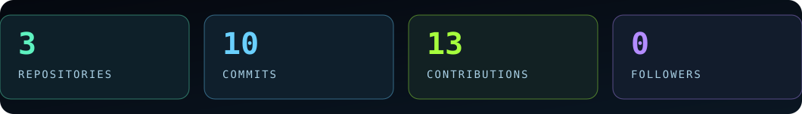
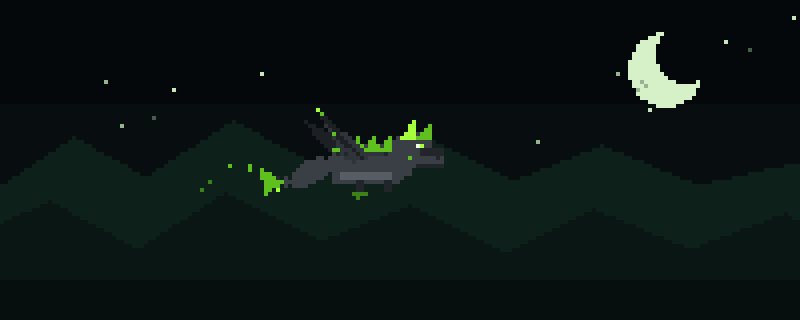

**Web3 hunter · automation builder · AI agent enjoyer**

Indonesia 🇮🇩 · Jakarta
Chasing airdrops, studying on-chain flows, learning bug bounty, and building scripts that do the boring work for me.

## ⚡ What I do

- 🎯 **Web3 / on-chain hunting** — Solana & EVM ecosystems, airdrop farming, testnets, and on-chain recon
- 🛠️ **Automation & scripting** — bots, helpers, and small tools to cut repetitive manual work
- 🤖 **AI agents** — experimenting with LLM workflows for research, ops, and coding tasks
- 🔍 **Bug bounty (learning path)** — building recon habits, notes, and methodology one target at a time

## 🚀 Current focus

- Exploring the Solana ecosystem and early-stage opportunities
- Automating repetitive crypto/research workflows
- Leveling up web security & bug bounty fundamentals
- Shipping more public experiments instead of keeping everything local

## 🧰 Stack & tools

  
  
  
  
  
  
  
  

## 📌 Public repos

- [**diki-wah**](https://github.com/diki-wah/diki-wah) — this profile README
- [**portfolio**](https://diki-wah.github.io/portfolio/) — personal site + Dragon Run canvas game
- [**sandbox**](https://github.com/diki-wah/sandbox) — playground for scripts, experiments, and quick automation ideas

## 📊 GitHub stats

Angka di kartu atas (`assets/stats.svg`) dibuat dari API GitHub langsung, tanpa layanan pihak ketiga.

## 🐉 Pixel dragon

> Still early — more builds, notes, and experiments coming as I ship in public.
